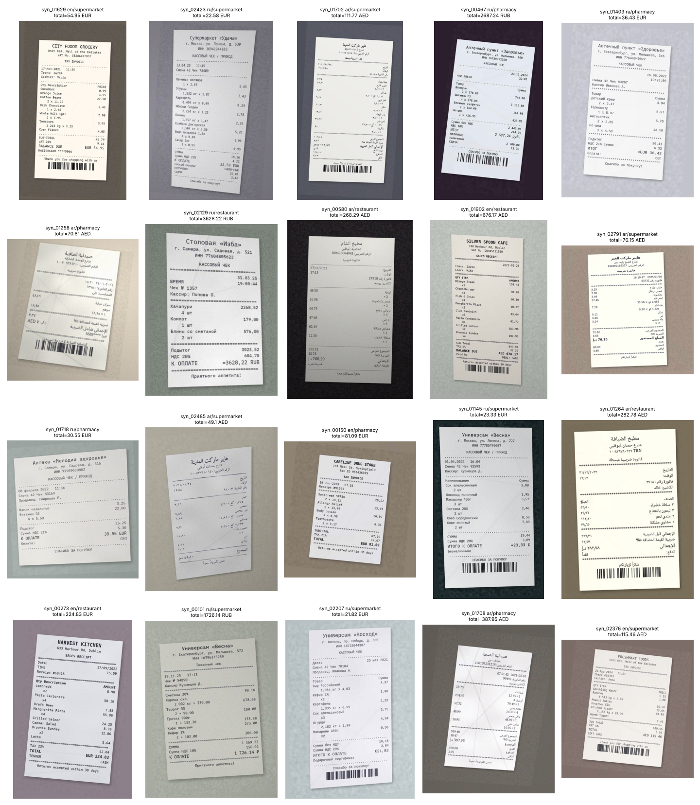

# receipt-vlm — receipt photos → strict JSON with a fine-tuned Qwen3-VL-2B

A small vision-language model (Qwen3-VL-2B-Instruct + LoRA SFT, then GRPO) that reads a photo of
a shop receipt — English, Arabic or Russian — and returns **one schema-valid JSON object**:
merchant, date, time, currency, line items, subtotal, tax, total, payment method and language.
The project is built as a short research study: the claim "a fine-tuned 2B model beats
zero-shot baselines, including larger models" is tested with bootstrap confidence intervals
and paired significance tests, not asserted.

> **Status (2026-10-22).** The full pipeline — data, synthetic generator, evaluation and
> statistics, SFT, GRPO, error analysis, serving, demo — is implemented, unit-tested
> (192 tests) and runs end to end on CPU with a tiny model (`make smoke`, 81 s).
> **No real model has been trained or evaluated yet**: the development container had no GPU
> and no access to huggingface.co. Every results table in
> [`reports/RESULTS.md`](reports/RESULTS.md) is generated from saved predictions and currently
> says *not run*. The exact GPU commands are in [Reproduce](#reproduce) and
> [`notebooks/train_colab.ipynb`](notebooks/train_colab.ipynb).

## Contents

1. [Research questions](#research-questions)
2. [Data](#data)
3. [Method](#method)
4. [Evaluation protocol](#evaluation-protocol)
5. [Results](#results)
6. [Reproduce](#reproduce)
7. [Serving and demo](#serving-and-demo)
8. [Repository layout](#repository-layout)
9. [What is verified, what is not](#what-is-verified-what-is-not)
10. [Limitations](#limitations)
11. [Licences](#licences)

## Research questions

| | Question | Comparison (paired on the same test images) |
|---|---|---|
| RQ1 | How much does LoRA SFT improve over zero-shot Qwen3-VL-2B? | M1 vs B1 |
| RQ2 | Does GRPO on top of SFT add a significant improvement, and on which fields? | M2 vs M1 |
| RQ3 | Fine-tuned 2B vs zero-shot 4B / 8B and OCR + text-LLM, in accuracy and latency | M1 vs B2, B3, B0 |
| RQ4 | Where does it fail (field, language, image quality)? | error taxonomy of the best model |

| ID | Model | Mode |
|---|---|---|
| B0 | Tesseract 5 OCR (two-pass, script-aware, PSM 6) + Qwen3-1.7B (thinking off) | zero-shot pipeline |
| B1 / B2 / B3 | Qwen3-VL-2B / 4B / 8B-Instruct (8B in 4-bit on 16 GB GPUs) | zero-shot |
| M1 | Qwen3-VL-2B + LoRA SFT | ours |
| M2 | M1 + GRPO | ours |

All models get the same prompt ([`prompts.py`](src/receipt_vlm/prompts.py)), greedy decoding,
the same `max_new_tokens` and the same image cap (≤ 1,048,576 px ≈ 1,024 visual tokens).

## Data

| Source | Content | Labelled fields | Split | In this build |
|---|---|---|---|---|
| [CORD v2](https://huggingface.co/datasets/naver-clova-ix/cord-v2) | 1,000 Indonesian receipts | items, subtotal, tax, total, payment (when unambiguous) | official | ✗ gap (HF blocked) |
| [SROIE](https://github.com/zzzDavid/ICDAR-2019-SROIE) | 626 Malaysian scans | merchant, date, total | 80/10/10, seeded | ✓ |
| WildReceipt (MMOCR) | 1,740 in-the-wild photos | merchant, date, time, subtotal, tax, total, items (when unambiguous) | official train/test, val carved | ✗ gap (host blocked) |
| Synthetic (ours) | 3,000 EN / AR / RU receipts | everything, exactly | 80/10/10 per language | ✓ |

**Label availability is per sample and per field.** A field is *labelled* only if its source
annotates it exhaustively; then a null gold value means "not printed", and predicting a value is
a false positive. Unlabelled fields are excluded from the loss *and* the metrics, so a model is
never punished for reading something the dataset forgot to annotate
([`DECISIONS.md`](DECISIONS.md) #7–11).

**Splits and leakage.** Exact (SHA-256) and near duplicates (256-bit pHash, Hamming ≤ 6 —
calibrated on SROIE, where 64-bit pHash put *different* receipts at distance 0) form atomic
groups that never straddle splits; official test splits are protected. The test manifest
(ids + hashes) is frozen and append-only: adding a source can never move an existing test
image, and the build fails if it would. Leakage tests run in CI on the committed manifests.

**Current build** (SROIE + synthetic; CORD and WildReceipt are appended by `make data` on a
machine with access, see [`reports/data_stats.md`](reports/data_stats.md)):

| source | train | val | test |
|---|---|---|---|
| SROIE | 497 | 62 | 62 |
| synthetic | 497 | 300 | 300 |

Synthetic train is capped at 50 % of train (1,903 synthetic train receipts are held back until
more real data is available).

**Synthetic generator** ([`data/synthetic/`](src/receipt_vlm/data/synthetic)). Three languages
× three layouts (supermarket, restaurant, pharmacy), currencies AED / USD / RUB / EUR. The gold
JSON is exactly what is printed, and the arithmetic always holds (Σ items = subtotal,
subtotal + tax = total). Arabic is shaped with `arabic-reshaper` and ordered right-to-left with
`python-bidi`, with a mirrored layout and Arabic-Indic digits on ~30 % of Arabic receipts.
Photo degradations: crumpled paper, perspective, ±7° rotation, uneven light, blur, sensor
noise and JPEG quality 35–91.



## Method

**Output contract.** Compact JSON with keys in schema order; strict validation (numbers must
be JSON numbers, dates real `YYYY-MM-DD`, ISO 4217 currency, unknown keys rejected —
[`schema.py`](src/receipt_vlm/schema.py)).

**SFT (Phase 4).** LoRA (r = 16, α = 32, dropout 0.05) on the language model's attention and MLP
projections; vision tower frozen; projector frozen or trainable (an ablation chosen on
validation F1). QLoRA 4-bit on 16 GB GPUs. The loss covers only the assistant answer:

$$\mathcal{L}_{\text{SFT}}(\theta) = -\frac{1}{|\mathcal{A}|}\sum_{t\in\mathcal{A}} \log p_\theta\!\left(y_t \mid y_{<t},\, x_{\text{image}},\, x_{\text{prompt}}\right)$$

where $y$ is the target JSON plus `<|im_end|>`, and $\mathcal{A}$ is the set of answer positions.
Every system, prompt and image token is excluded (label −100). With partial-label masking,
$\mathcal{A}$ also excludes the **value** tokens of fields the sample's source does not label
(e.g. `"items":[]` on SROIE). This way the model is not taught to suppress fields it can see.
A unit test checks both on real tokenised examples. Checkpoints are selected by
*generation-based* validation F1 on a fixed, source-stratified 200-image subset, never by loss.

**GRPO (Phase 6).** Start from the best SFT checkpoint, merged into the base so that the KL
reference is the SFT policy, and train a fresh LoRA. For a group of $G$ sampled answers
$o_1, \dots, o_G$ to one receipt, the advantage is $\hat A_i = (R_i - \bar R)/\sigma_R$. The
reward reuses the evaluation code:

$$R = \frac{\sum_{k\in\mathcal{K}} w_k\, r_k}{\sum_{k\in\mathcal{K}} w_k},\qquad (w_{\text{format}}, w_{\text{fields}}, w_{\text{total}}, w_{\text{cons}}) = (0.2,\ 0.5,\ 0.2,\ 0.1)$$

- $r_\text{format}$ = 1 if the answer is schema-valid JSON;
- $r_\text{fields}$ = the sample's micro-F1 over labelled fields (0 if invalid);
- $r_\text{total}$ = 1 if the total is within 0.01;
- $r_\text{cons}$ = 1 if the predicted numbers add up.

$\mathcal{K}$ is the set of applicable components. When the total is unlabelled, or the gold
receipt itself does not add up (e.g. service charges), that component's weight is
redistributed, so no one gets free points. An all-null answer scores $r_\text{fields} = 0$. KL
coefficient β = 0.04, group size 4–8, learning rate 5·10⁻⁶. Null-rate per field, output length,
KL and each reward component are logged every step, and a monitor flags "null rate rising
while reward rises".

## Evaluation protocol

Counting rule for one labelled field instance (gold $g$, prediction $p$):

| $g$ | $p$ | counts |
|---|---|---|
| null | null | — (correct abstention) |
| null | value | FP |
| value | null | FN |
| value | $= g$ | TP |
| value | $\ne g$ | FP + FN |

$$\text{F1} = \frac{2\,TP}{2\,TP + FP + FN}$$

The **primary metric** is micro-F1 over all field instances. Scalar fields are compared after
normalisation (NFKC, lower case, whitespace; numbers equal within 0.01). Item attributes are
compared after Hungarian matching of predicted to gold items, with score
0.6·name-similarity + 0.4·[totals equal]; inadmissible pairs are never matched.
Schema-invalid output counts as an empty prediction; a lenient F1 that coerces field by field
is reported separately.

Secondary metrics: JSON parse rate, schema-valid rate, total exact match, item
precision/recall/F1, per-attribute accuracy, merchant string similarity, arithmetic
consistency, and latency p50/p95.

**Statistics.**
- 95 % percentile bootstrap CIs over images (2,000 resamples). Every metric is a function of
  additive per-image counts, so the resampled corpora are a single matrix product.
- Paired bootstrap for every model comparison: Δ, its CI, and the share of resamples with
  Δ ≤ 0.
- McNemar's test on total exact match: exact binomial when there are fewer than 25 discordant
  pairs, else χ² with continuity correction.
- Breakdowns by language and source; subgroups with < 50 images are flagged *low-n*.

A unit test computes an F1 by hand (20/27) and a McNemar p-value (79/2048), and checks the
code against both.

## Results

**Not available yet** — see the status note at the top. [`reports/RESULTS.md`](reports/RESULTS.md)
holds the protocol, the RQ sections (pending) and auto-generated tables that list B0–B3, M1 and
M2 as *not run*. Once predictions exist, `make report` fills in:

- the headline table with CIs;
- per-field F1;
- by-language and by-source breakdowns;
- paired comparisons with McNemar;
- three figures (overall F1 with CIs, per-field heatmap, latency vs F1).

`scripts/error_analysis.py` adds the RQ4 taxonomy, error rate by image sharpness and annotated
examples. This README will quote only numbers that appear in RESULTS.md.

## Reproduce

**CPU, any machine** — proves the pipeline, produces no meaningful numbers:

```bash
cd receipt-vlm
make setup        # uv sync (Python 3.12); apt install tesseract-ocr{,-ara,-rus} for B0
make check        # ruff + mypy (strict on schema/eval/rewards) + 192 tests
make smoke        # tiny random Qwen3-VL: data → SFT → eval → GRPO → report → errors → merge → API
```

**GPU (one 16 GB card is enough; ≥ 24 GB use `gpu24plus` configs)** — the real study:

```bash
make setup-gpu
make data && make synth                 # adds CORD + WildReceipt; frozen test entries cannot move
uv run pytest -m data                   # converters over the full real datasets
make eval-baselines SPLIT=val           # B0–B3 on validation
make sft CONFIG=configs/sft/gpu16.yaml  # M1 (+ projector ablation: lora.train_projector=true)
make eval MODEL=M1 SPLIT=val
make grpo CONFIG=configs/grpo/gpu16.yaml
make eval MODEL=M2 SPLIT=val
uv run python scripts/run_eval.py --config configs/eval/final.yaml --split test --models B0 B1 B2 B3 M1 M2
make report
uv run python scripts/error_analysis.py --model M2 --split test
```

Every experiment is one YAML config plus one command. Configs support `_base_` inheritance
and `key.sub=value` overrides, and runs are seeded. Predictions are saved as JSONL
(`outputs/preds/<model>/<split>.jsonl`: raw text, latency), so metrics can be recomputed
without re-running models.

## Serving and demo

```bash
make merge && make serve                 # vLLM (OpenAI API, :8001) + FastAPI validator (:8000)
docker compose up --build                # same, in containers (vllm/vllm-openai:v0.30.0)
curl -F image=@receipt.jpg localhost:8000/extract
make demo                                # Gradio: JSON + items table + arithmetic check
```

`POST /extract` validates the model output with the evaluation parser. On invalid output it
retries **once**, appending the answer plus a "return valid JSON only" reminder to the
conversation. If the output is still invalid it returns **422** with the raw text.

There is also a CPU variant: `docker-compose.cpu.yml`, which uses an in-process transformers
backend. It was run in the development container: `curl … /extract` returned a valid receipt
from the tiny test model. The llama.cpp (GGUF) fallback and all details are in
[`docs/serving.md`](docs/serving.md). Other pieces:

- `scripts/push_to_hub.py` uploads the adapter and the merged model with a generated model
  card. The card states "not evaluated" until test metrics exist.
- [`examples/telegram_bot_client.py`](examples/telegram_bot_client.py) connects this model to
  the expense bot in the parent repository.

## Repository layout

```
configs/            data.yaml, sft/{smoke,gpu16,gpu24plus}, grpo/{smoke,gpu16}, eval/{baselines,final,smoke}
src/receipt_vlm/    schema, prompts, values, data/ (converters, synthetic, splits, dedup, collate),
                    models/ (load, inference, tiny), eval/ (parse, normalize, metrics, items_matching,
                    bootstrap, significance, report, errors, runner), rewards/, train/ (sft, grpo),
                    baselines/ (OCR + LLM), serve/ (api, backends, extract)
scripts/            build_data, generate_synthetic, run_eval, train_sft, train_grpo, merge_lora,
                    make_report, error_analysis, push_to_hub, smoke, serve.sh
app/ notebooks/ docs/ examples/ tests/ reports/      outputs/ and data/ (except split manifests) are gitignored
PROGRESS.md         state of every phase, DoD gaps, exact GPU commands
DECISIONS.md        42 logged decisions: problem → choice → why → trade-off
```

## What is verified, what is not

Verified in this repository (tests or recorded runs):
- **Converters:** run on verbatim SROIE and WildReceipt records. CORD is checked only against
  structure-faithful fixtures; a data-marked test runs on the real set.
- **Leakage:** the split manifests contain no exact or near-duplicate image across splits.
- **Synthetic data:**
  - Every gold value appears in the printed text, and the arithmetic holds on 600 specs.
  - Arabic is shaped and right-to-left; the sample grid was checked visually.
- **Metrics:** match hand-computed F1 and McNemar values. The bootstrap reproduces binomial
  CI widths, and the paired bootstrap detects a planted 30-point gap.
- **Training wiring:**
  - Label masking is checked on tokenised examples.
  - The tiny model memorises two receipts through the real SFT path (val F1 = 1.0).
  - GRPO assigns reward 1.0 to exact completions inside TRL; gradients and LoRA updates
    appear once group rewards vary.
  - LoRA never touches the vision tower.
- **Inference and serving:**
  - Batched greedy decoding equals unbatched.
  - Merged weights equal base + adapters.
  - API retry/422/400/413/502 paths are covered.
  - The CPU Docker stack answers `curl`, and the Gradio app serves.

**Not verified here:** anything that needs a real model or a GPU. That covers all accuracy and
latency numbers, the Unsloth fast path, the vLLM container, the llama.cpp recipe and the
Hub upload.

## Limitations

- Real training data is small, and in this build English-only (SROIE). Arabic and Russian
  are covered by synthetic receipts, which are exact but stylised: no logos, handwriting or
  folded corners.
- B0 uses Tesseract rather than PaddleOCR, which favours the VLMs in RQ3.
- Images are capped at ≈ 1 MP, so very long receipts lose resolution.
- WildReceipt item labels are reconstructed from word boxes and kept only when unambiguous,
  so item metrics on WildReceipt come from simpler receipts.
- The pHash threshold was calibrated on SROIE only; re-check it after adding other sources.

## Licences

Code: Apache-2.0. Base models: Qwen3-VL and Qwen3 (Apache-2.0). Data:

| Source | Licence | Notes |
|---|---|---|
| CORD v2 | CC BY 4.0 | |
| SROIE | ICDAR 2019, research use | via the MIT-licensed mirror `zzzDavid/ICDAR-2019-SROIE` |
| WildReceipt | MMOCR, no explicit licence | |
| Synthetic receipts and fonts | ours; fonts OFL from google/fonts | pinned commit |

Models fine-tuned on SROIE/WildReceipt inherit research-use restrictions from that data.
Datasets and weights are never committed; split manifests contain only ids and hashes.
