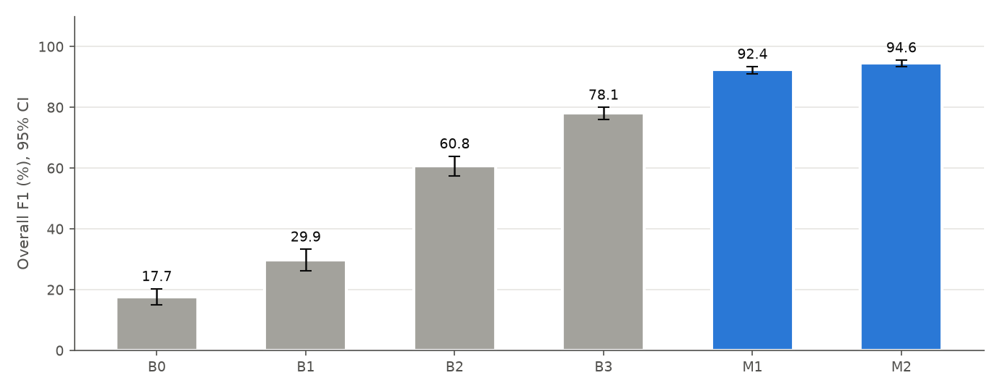
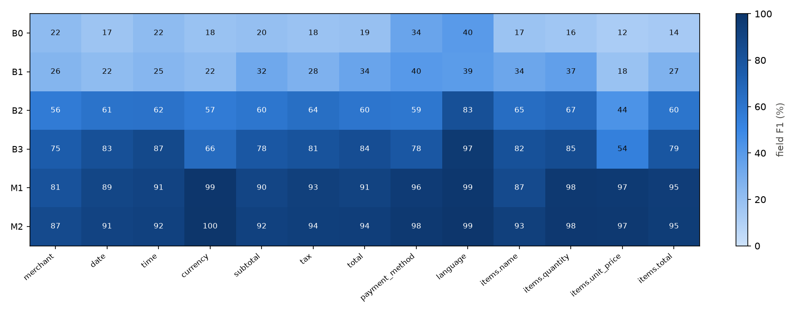
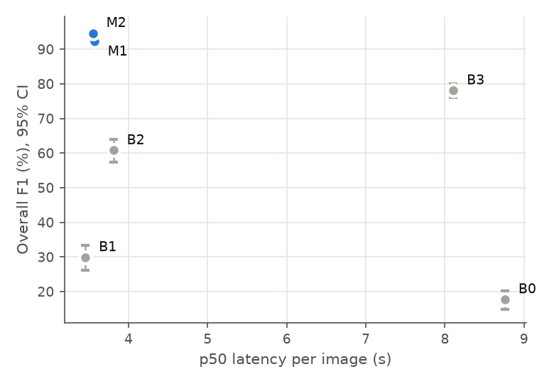

# Results

> **Status (2026-10-25): validation complete; no test results.** All six models were run on
> val on one RTX 4090 (RunPod, `configs/*/gpu16.yaml`, Hugging Face backend), so latencies are
> comparable across models. The test predictions were lost with the GPU server before they were
> downloaded, so the test section below is *not run*; val was also used for checkpoint
> selection, so the val numbers are slightly optimistic. Every table below is generated by
> `make report` from saved predictions in `outputs/preds/`. No number in this file is
> hand-entered.

## Protocol

- **Data:** `reports/data_stats.md`. Frozen test manifest `data/splits/test_manifest.jsonl`
  (ids + image hashes); validation for every tuning decision; test evaluated once per model.
- **Prompt:** one fixed system prompt + instruction (`src/receipt_vlm/prompts.py`, version `v1`)
  for every model, including the OCR + LLM baseline (which receives OCR text instead of pixels).
- **Decoding:** greedy (temperature 0), `max_new_tokens = 1024`, same image cap for all VLMs
  (Qwen3-VL resizing to ≤ 1,048,576 px, i.e. ≤ 1,024 visual tokens).
- **Primary metric:** strict micro-F1 over all labelled field instances (scalar fields + item
  attributes after Hungarian matching); a schema-invalid output scores as an empty prediction.
  Unlabelled fields are never scored (`DECISIONS.md` #7). Secondary: lenient F1, JSON parse rate,
  schema-valid rate, total exact match, item P/R/F1, merchant similarity, arithmetic consistency,
  latency p50/p95.
- **Statistics:** 95 % percentile bootstrap CIs (2,000 resamples over images); paired bootstrap
  for every model comparison (difference, CI, share of resamples with Δ ≤ 0); McNemar on total
  exact match. Subgroups with < 50 images are flagged *low-n*.

## RQ1 — How much does LoRA SFT improve over zero-shot Qwen3-VL-2B?

_Pending: requires B1 and M1 predictions (comparison `M1 vs B1` below)._

## RQ2 — Does GRPO on top of SFT add a significant improvement, and on which fields?

_Pending: requires M1 and M2 predictions (comparison `M2 vs M1`, per-field table)._

## RQ3 — Fine-tuned 2B vs zero-shot 4B/8B and OCR + LLM, in accuracy and latency

_Pending: requires B0, B2, B3, M1 predictions (comparisons `M1 vs B2/B3/B0`, latency figure).
Latency numbers are only comparable when measured with the same backend on the same GPU._

## RQ4 — Where does it fail?

_Pending: requires predictions of the best model; `scripts/error_analysis.py` produces the
taxonomy table and annotated examples._

## Known limitations of the setup

- The B0 OCR stage is Tesseract 5 (two-pass, script-aware, PSM 6), not PaddleOCR; Tesseract is
  weaker on photographed receipts, which favours the VLMs in RQ3.
- SROIE has no official labelled test split in the mirror we use; its test images are a seeded
  10 % of the 626 labelled receipts.
- Synthetic receipts are exact but stylised; the synthetic test subset is reported separately
  from real sources in the by-source tables.

## Results on `val` (auto-generated)

<!-- BEGIN AUTO:val -->
_Auto-generated by `make report` on 2026-10-23 from `outputs/preds`; prompt `v1`, max_new_tokens=1024, image cap 1048576 px, greedy decoding; 95% percentile-bootstrap CIs (2000 resamples over images, seed 1234). Do not edit by hand._

### Headline metrics (val, n = 602)

| Model | Setup | n | Overall F1 | Lenient F1 | JSON parse | Schema-valid | Total EM | Item F1 | p50 / p95 s |
|---|---|---|---|---|---|---|---|---|---|
| **B0** | Tesseract 5 OCR (2-pass script-aware, PSM 6) + Qwen3-1.7B (thinking off), zero-shot | 602 | 17.7 [14.9, 20.3] | 48.4 [45.9, 50.8] | 95.0 [93.2, 96.7] | 38.9 [34.9, 42.9] | 12.8 [10.1, 15.5] | 7.8 [5.7, 9.8] | 8.76 / 16.51 |
| **B1** | Qwen3-VL-2B-Instruct, zero-shot | 602 | 29.9 [26.2, 33.3] | 67.8 [65.4, 70.0] | 98.7 [97.7, 99.5] | 32.7 [28.9, 36.4] | 22.9 [19.5, 26.3] | 22.5 [18.3, 26.4] | 3.46 / 6.25 |
| **B2** | Qwen3-VL-4B-Instruct, zero-shot | 602 | 60.8 [57.4, 63.9] | 71.4 [68.9, 73.6] | 98.5 [97.5, 99.3] | 67.1 [63.3, 70.9] | 50.9 [46.7, 54.8] | 52.7 [48.0, 57.1] | 3.81 / 10.66 |
| **B3** | Qwen3-VL-8B-Instruct, zero-shot (4-bit NF4 on 16 GB GPUs) | 602 | 78.1 [76.0, 80.0] | 79.1 [77.2, 80.9] | 99.3 [98.7, 99.8] | 92.5 [90.5, 94.5] | 82.3 [79.3, 85.4] | 70.1 [66.1, 73.9] | 8.11 / 14.85 |
| **M1** | Qwen3-VL-2B + LoRA SFT (ours) | 602 | 92.4 [91.1, 93.4] | 92.6 [91.4, 93.6] | 96.8 [95.3, 98.2] | 96.3 [94.7, 97.8] | 90.1 [87.6, 92.5] | 83.6 [80.3, 86.7] | 3.57 / 5.80 |
| **M2** | M1 + GRPO (ours) | 602 | 94.6 [93.5, 95.6] | 94.7 [93.6, 95.6] | 99.7 [99.2, 100.0] | 99.5 [98.8, 100.0] | 94.3 [92.3, 96.1] | 89.9 [87.1, 92.1] | 3.55 / 5.87 |

### Per-field F1 (strict), support = gold non-null instances

| Field | support | B0 | B1 | B2 | B3 | M1 | M2 |
|---|---|---|---|---|---|---|---|
| merchant | 458 | 22.0 [17.4, 26.4] | 25.5 [20.6, 30.5] | 56.2 [51.7, 60.5] | 74.7 [70.9, 78.2] | 81.1 [77.5, 84.7] | 86.7 [83.5, 89.7] |
| date | 464 | 16.9 [12.4, 21.3] | 21.7 [16.8, 26.6] | 61.4 [56.7, 65.8] | 82.6 [79.2, 85.8] | 89.2 [86.5, 91.7] | 90.8 [88.1, 93.4] |
| time | 363 | 22.0 [16.5, 27.4] | 24.7 [19.4, 30.0] | 62.0 [57.0, 66.8] | 87.2 [84.0, 90.3] | 90.7 [87.8, 93.5] | 91.9 [89.1, 94.6] |
| currency | 300 | 18.0 [12.8, 23.3] | 21.9 [16.0, 27.6] | 56.8 [50.9, 62.8] | 66.3 [61.0, 71.6] | 99.5 [98.8, 100.0] | 99.8 [99.5, 100.0] |
| subtotal | 438 | 19.6 [15.3, 23.8] | 32.2 [27.3, 37.0] | 59.7 [55.2, 63.9] | 77.8 [74.4, 81.1] | 89.8 [87.3, 92.1] | 92.0 [89.8, 94.1] |
| tax | 390 | 17.7 [13.1, 22.2] | 27.5 [22.5, 32.4] | 63.7 [59.0, 68.0] | 80.7 [77.1, 84.1] | 93.1 [90.8, 95.2] | 93.7 [91.4, 95.8] |
| total | 576 | 19.1 [15.3, 22.8] | 34.2 [29.7, 38.3] | 59.9 [55.8, 63.8] | 84.3 [81.5, 87.0] | 91.2 [89.0, 93.3] | 93.9 [91.9, 95.6] |
| payment_method | 339 | 34.4 [28.4, 39.5] | 40.1 [34.1, 45.5] | 59.1 [53.7, 64.1] | 78.0 [73.6, 82.0] | 95.9 [94.0, 97.6] | 97.7 [96.0, 99.0] |
| language | 300 | 39.7 [33.3, 45.6] | 39.0 [32.3, 45.3] | 82.6 [78.9, 86.0] | 96.9 [95.4, 98.2] | 98.8 [97.6, 99.7] | 99.5 [98.6, 100.0] |
| items.name | 2053 | 17.4 [13.8, 20.7] | 33.6 [28.8, 38.0] | 64.6 [60.4, 68.7] | 81.9 [78.9, 84.5] | 86.5 [83.4, 89.3] | 93.0 [90.7, 94.8] |
| items.quantity | 1406 | 15.7 [11.9, 19.7] | 36.8 [32.0, 41.5] | 67.5 [63.4, 71.6] | 85.0 [82.4, 87.5] | 97.6 [96.2, 98.8] | 98.0 [96.7, 99.0] |
| items.unit_price | 784 | 12.2 [8.4, 16.2] | 18.3 [12.7, 23.8] | 43.6 [37.8, 48.8] | 53.8 [48.9, 58.9] | 96.7 [94.9, 98.3] | 97.3 [95.8, 98.5] |
| items.total | 2051 | 14.0 [10.9, 17.1] | 27.2 [22.6, 31.4] | 60.4 [56.0, 64.8] | 78.8 [75.2, 82.3] | 94.7 [92.8, 96.3] | 95.1 [93.3, 96.6] |

### By language (overall F1)

| language | n | B0 F1 | B1 F1 | B2 F1 | B3 F1 | M1 F1 | M2 F1 |
|---|---|---|---|---|---|---|---|
| ar | 100 | 17.4 [13.1, 21.6] | 21.1 [15.9, 26.1] | 37.8 [32.0, 43.4] | 58.2 [52.7, 63.2] | 93.4 [90.7, 95.8] | 94.5 [92.3, 96.6] |
| en | 303 | 16.2 [11.0, 21.2] | 21.6 [15.2, 27.7] | 68.6 [64.1, 72.7] | 83.5 [81.3, 85.6] | 87.5 [85.4, 89.5] | 91.8 [90.0, 93.5] |
| id | 99 | 27.7 [22.9, 33.0] | 67.7 [62.5, 72.9] | 66.3 [61.0, 71.5] | 75.6 [69.9, 80.5] | 89.9 [86.0, 93.3] | 92.5 [88.8, 95.6] |
| ru | 100 | 13.8 [7.3, 20.4] | 24.6 [14.8, 34.5] | 69.2 [62.5, 75.0] | 88.1 [85.9, 90.0] | 99.5 [99.2, 99.7] | 99.6 [99.4, 99.9] |

### By source (overall F1)

| source | n | B0 F1 | B1 F1 | B2 F1 | B3 F1 | M1 F1 | M2 F1 |
|---|---|---|---|---|---|---|---|
| cord | 99 | 27.7 [22.9, 33.0] | 67.7 [62.5, 72.9] | 66.3 [61.0, 71.5] | 75.6 [69.9, 80.5] | 89.9 [86.0, 93.3] | 92.5 [88.8, 95.6] |
| sroie | 62 | 0.0 [0.0, 0.0] | 0.0 [0.0, 0.0] | 25.8 [14.5, 37.0] | 78.6 [71.0, 85.6] | 80.5 [73.6, 86.7] | 91.4 [87.6, 95.2] |
| synthetic | 300 | 16.9 [13.4, 20.4] | 22.8 [18.3, 27.3] | 62.0 [58.0, 65.7] | 80.0 [77.5, 82.1] | 96.0 [94.8, 97.0] | 97.9 [97.1, 98.6] |
| wildreceipt | 141 | 11.8 [7.4, 16.8] | 21.8 [13.2, 30.3] | 50.1 [42.8, 56.7] | 67.7 [62.9, 72.2] | 72.6 [68.5, 76.4] | 75.6 [71.7, 79.3] |

### Paired comparisons (paired bootstrap over images; McNemar on total exact match)

| A vs B | metric | Δ (A−B), pts | 95% CI | P(Δ ≤ 0) | significant |
|---|---|---|---|---|---|
| M1 vs B1 | overall_f1 | +62.5 | [+58.9, +66.3] | 0.000 | yes |
| M1 vs B1 | total_em | +67.2 | [+63.4, +71.0] | 0.000 | yes |
| M1 vs B1 | schema_valid_rate | +63.6 | [+59.8, +67.4] | 0.000 | yes |
| M1 vs B1 | item_f1 | +61.2 | [+56.4, +66.2] | 0.000 | yes |
| M1 vs B1 | total EM, McNemar | 388 vs 1 discordant | stat 383.02 | p = 0.0000 (χ²) | yes |
| M2 vs M1 | overall_f1 | +2.3 | [+1.6, +2.9] | 0.000 | yes |
| M2 vs M1 | total_em | +4.2 | [+2.4, +6.0] | 0.000 | yes |
| M2 vs M1 | schema_valid_rate | +3.2 | [+1.8, +4.7] | 0.000 | yes |
| M2 vs M1 | item_f1 | +6.2 | [+4.1, +8.4] | 0.000 | yes |
| M2 vs M1 | total EM, McNemar | 26 vs 2 discordant | stat 18.89 | p = 0.0000 (χ²) | yes |
| M1 vs B2 | overall_f1 | +31.6 | [+28.5, +34.9] | 0.000 | yes |
| M1 vs B2 | total_em | +39.2 | [+35.0, +43.6] | 0.000 | yes |
| M1 vs B2 | schema_valid_rate | +29.2 | [+25.4, +33.2] | 0.000 | yes |
| M1 vs B2 | item_f1 | +30.9 | [+26.0, +36.2] | 0.000 | yes |
| M1 vs B2 | total EM, McNemar | 234 vs 8 discordant | stat 209.19 | p = 0.0000 (χ²) | yes |
| M1 vs B3 | overall_f1 | +14.3 | [+12.6, +16.2] | 0.000 | yes |
| M1 vs B3 | total_em | +7.8 | [+4.6, +11.0] | 0.000 | yes |
| M1 vs B3 | schema_valid_rate | +3.8 | [+1.3, +6.5] | 0.002 | yes |
| M1 vs B3 | item_f1 | +13.6 | [+9.4, +17.7] | 0.000 | yes |
| M1 vs B3 | total EM, McNemar | 69 vs 24 discordant | stat 20.82 | p = 0.0000 (χ²) | yes |
| M1 vs B0 | overall_f1 | +74.6 | [+71.8, +77.5] | 0.000 | yes |
| M1 vs B0 | total_em | +77.3 | [+73.9, +80.7] | 0.000 | yes |
| M1 vs B0 | schema_valid_rate | +57.5 | [+53.2, +61.8] | 0.000 | yes |
| M1 vs B0 | item_f1 | +75.9 | [+72.2, +79.5] | 0.000 | yes |
| M1 vs B0 | total EM, McNemar | 446 vs 1 discordant | stat 441.02 | p = 0.0000 (χ²) | yes |
<!-- END AUTO:val -->

## Results on `test` (auto-generated)

<!-- BEGIN AUTO:test -->
_Auto-generated by `make report` on 2026-10-23 from `outputs/preds`; prompt `v1`, max_new_tokens=1024, image cap 1048576 px, greedy decoding; 95% percentile-bootstrap CIs (2000 resamples over images, seed 1234). Do not edit by hand._

### Headline metrics (test, n = 934)

| Model | Setup | n | Overall F1 | Lenient F1 | JSON parse | Schema-valid | Total EM | Item F1 | p50 / p95 s |
|---|---|---|---|---|---|---|---|---|---|
| B0 | Tesseract 5 OCR (2-pass script-aware, PSM 6) + Qwen3-1.7B (thinking off), zero-shot — no complete predictions for `test` (0/934) | – | not run | not run | not run | not run | not run | not run | – |
| B1 | Qwen3-VL-2B-Instruct, zero-shot — no complete predictions for `test` (0/934) | – | not run | not run | not run | not run | not run | not run | – |
| B2 | Qwen3-VL-4B-Instruct, zero-shot — no complete predictions for `test` (0/934) | – | not run | not run | not run | not run | not run | not run | – |
| B3 | Qwen3-VL-8B-Instruct, zero-shot (4-bit NF4 on 16 GB GPUs) — no complete predictions for `test` (0/934) | – | not run | not run | not run | not run | not run | not run | – |
| M1 | Qwen3-VL-2B + LoRA SFT (ours) — no complete predictions for `test` (0/934) | – | not run | not run | not run | not run | not run | not run | – |
| M2 | M1 + GRPO (ours) — no complete predictions for `test` (0/934) | – | not run | not run | not run | not run | not run | not run | – |

_No comparison could be computed: at least one model of every configured pair has no predictions yet._
<!-- END AUTO:test -->
